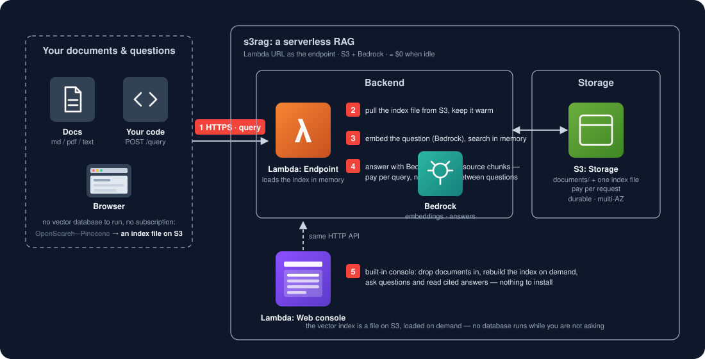

# s3rag — a truly serverless RAG

**The vector index is a file on S3.** Every RAG tutorial begins with "run a vector database" —
OpenSearch Serverless (~$350/month floor), an RDS with pgvector, or a Pinecone subscription —
a server that sits there all day for a corpus you query a few times an hour at most. s3rag
removes it: documents live in `s3://…/documents/`, an on-demand job builds **one index file**
(Bedrock embeddings) next to them, and a Lambda (Function URL) loads that file into memory to
answer queries — embed the question, search in memory, answer with Bedrock, cite the source
chunks. Between questions, nothing runs: **≈ $0 when idle, pay per query.**

Part of the [Redefine AWS Serverless](https://cloudformer.github.io) series: same sign-in
(password or Cloudflare Access), same built-in web console, deployed by one Terraform module.

## Status

`0.0.1` — the name is reserved and this repository holds the design: the architecture above,
the series skeleton (client package, Terraform caller, compat tests) still to be filled. The
console will do three things: drop documents in, rebuild the index on demand, ask questions
and read cited answers.

[中文说明](README.zh.md)
