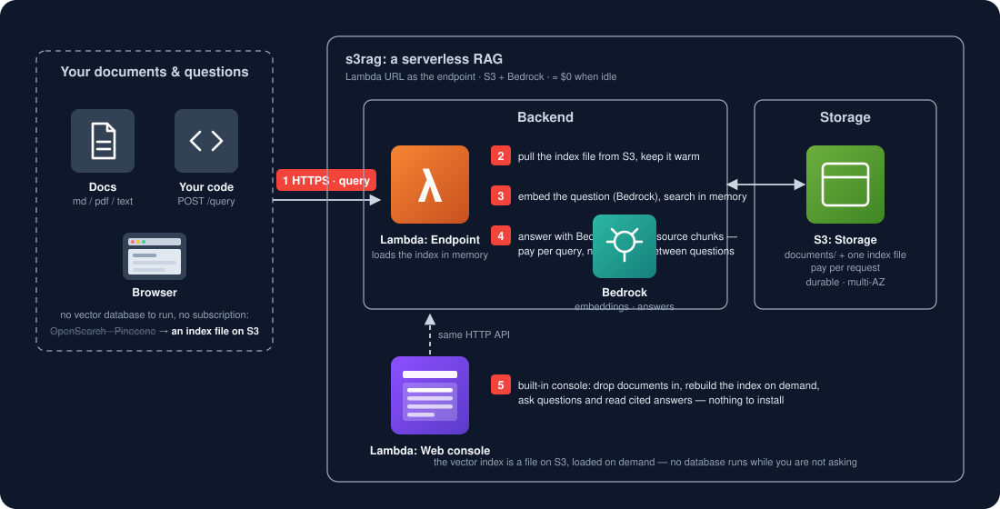

# s3rag — 真正无服务器的 RAG

**向量索引就是 S3 上的一个文件。** 所有 RAG 教程的第一步都是"先跑一个向量数据库"——
OpenSearch Serverless（每月 ~$350 起）、带 pgvector 的 RDS、或 Pinecone 订阅——为一个每小时
最多查几次的语料库养一台整天开着的服务器。s3rag 把它去掉：文档放在 `s3://…/documents/`，
按需任务用 Bedrock embeddings 在旁边生成**一个索引文件**，Lambda（Function URL）把这个文件
加载进内存来回答问题——向量化问题、内存中检索、Bedrock 生成答案并引用原文片段。
没人提问时，什么都不在跑：**待机 ≈ $0，按查询付费。**

[Redefine AWS Serverless](https://cloudformer.github.io) 系列成员：同一套登录（密码或
Cloudflare Access）、同一个内置网页控制台、一个 Terraform 模块部署。

## 状态

`0.0.1` —— 名字已占，本仓库目前是设计：上面的架构图 + 系列骨架（client 包、Terraform
调用、兼容测试）待填充。控制台将做三件事：丢文档进去、按需重建索引、提问并阅读带引用的回答。

[English](README.md)
